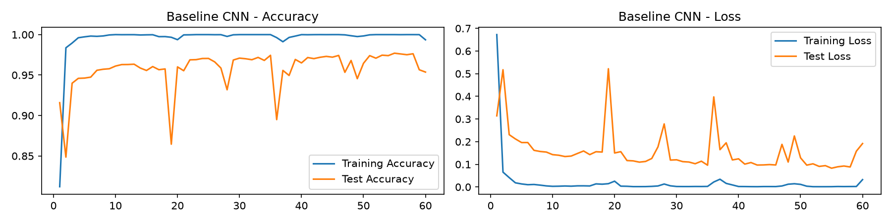
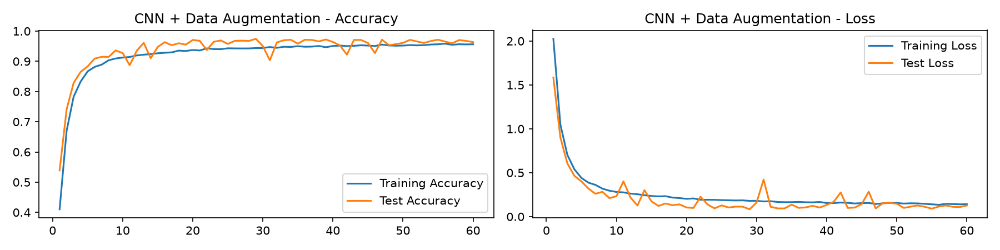

# CNN
## 理论基础

1. 卷积层是什么？有什么作用？
卷积层用一组可学习的卷积核（滤波器）在输入特征图上滑动，每个位置做一次逐元素相乘再求和，得到一张输出特征图。它的作用是提取局部特征：浅层卷积核学到的是边缘、颜色块、纹理等低级特征，层数加深后，后面层会把前面的低级特征组合成部件、再到完整的物体语义。

2. 卷积层相比全连接层的优势
①大大减少了参数数量；②可以保留空间结构，避免简单地将图像拉平成一维；③具有平移不变性。

3. 卷积核越大，模型一定越好吗？为什么很多 CNN 更喜欢连续使用多个较小的卷积核，而不是直接使用一个很大的卷积核？
不一定。比如两个3×3卷积堆叠，感受野等于一个5×5；三个3×3堆叠等于一个7×7。
- 参数更少：3个3×3的参数量是 `3 × 9C² = 27C²`，而一个 7×7 是 `49C²`；
- 非线性更强：每层卷积后面都接激活函数，三层就有三次非线性变换，判别能力更强；
- 计算量也更省：以 `C` 通道为例，三个 3×3 的计算量约 `3×9C² = 27C²`，小于 7×7 的 `49C²`。

4. Pooling 有什么作用？Max Pooling 和 Average Pooling 分别做了什么？
池化在局部窗口内做下采样，主要作用为：①降低特征图尺寸（减少计算量、显存占用）；②扩大后续层的感受野；③提供一定的平移不变性（小范围移动不影响池化结果），同时丢掉一部分细节起到轻度正则化作用。

- Max Pooling：取窗口内最大值，保留最强响应（最显著的特征），更常用。
- Average Pooling：取窗口内平均值
保留整体信息、更平滑，常用于网络末端（全局平均池化代替全连接）。

5. 什么是感受野？
感受野是输出特征图上的一个像素，对应到原始输入图像上的区域大小，描述了这个神经元能看到多大范围的信息。
感受野随层数增长。

6. 输出尺寸计算
`H_out = ⌊(H_in + 2P − K) / S⌋ + 1`
- 第一层：H_in=32,K=5,P=2,S=1
H_out=(32+2*2-5)/1+1=32
输出通道数不变
输出是32×32×16
- 第二层：H_in=32,K=2,S=2,P=0
H_out=(32+0-2)/2+1=16
输出是16×16×16

## 运行结果

===== 原CNN =====
[baseline] Epoch:1,Train_acc:81.2%,Train_loss:0.6725,Test_acc:91.6%,Test_loss:0.3140
[baseline] Epoch:2,Train_acc:98.4%,Train_loss:0.0656,Test_acc:84.9%,Test_loss:0.5175
[baseline] Epoch:3,Train_acc:99.0%,Train_loss:0.0415,Test_acc:94.0%,Test_loss:0.2309
[baseline] Epoch:4,Train_acc:99.6%,Train_loss:0.0184,Test_acc:94.6%,Test_loss:0.2121
[baseline] Epoch:5,Train_acc:99.7%,Train_loss:0.0135,Test_acc:94.6%,Test_loss:0.1961
[baseline] Epoch:6,Train_acc:99.8%,Train_loss:0.0101,Test_acc:94.7%,Test_loss:0.1962
[baseline] Epoch:7,Train_acc:99.8%,Train_loss:0.0111,Test_acc:95.6%,Test_loss:0.1618
[baseline] Epoch:8,Train_acc:99.8%,Train_loss:0.0082,Test_acc:95.7%,Test_loss:0.1567
[baseline] Epoch:9,Train_acc:100.0%,Train_loss:0.0048,Test_acc:95.8%,Test_loss:0.1541
[baseline] Epoch:10,Train_acc:100.0%,Train_loss:0.0030,Test_acc:96.1%,Test_loss:0.1428
[baseline] Epoch:11,Train_acc:100.0%,Train_loss:0.0035,Test_acc:96.3%,Test_loss:0.1401
[baseline] Epoch:12,Train_acc:100.0%,Train_loss:0.0044,Test_acc:96.3%,Test_loss:0.1344
[baseline] Epoch:13,Train_acc:100.0%,Train_loss:0.0036,Test_acc:96.3%,Test_loss:0.1365
[baseline] Epoch:14,Train_acc:100.0%,Train_loss:0.0051,Test_acc:95.9%,Test_loss:0.1479
[baseline] Epoch:15,Train_acc:100.0%,Train_loss:0.0051,Test_acc:95.6%,Test_loss:0.1589
[baseline] Epoch:16,Train_acc:100.0%,Train_loss:0.0046,Test_acc:96.0%,Test_loss:0.1429
[baseline] Epoch:17,Train_acc:99.7%,Train_loss:0.0137,Test_acc:95.7%,Test_loss:0.1557
[baseline] Epoch:18,Train_acc:99.8%,Train_loss:0.0123,Test_acc:95.8%,Test_loss:0.1542
[baseline] Epoch:19,Train_acc:99.7%,Train_loss:0.0146,Test_acc:86.5%,Test_loss:0.5219
[baseline] Epoch:20,Train_acc:99.4%,Train_loss:0.0256,Test_acc:96.0%,Test_loss:0.1501
[baseline] Epoch:21,Train_acc:100.0%,Train_loss:0.0037,Test_acc:95.5%,Test_loss:0.1559
[baseline] Epoch:22,Train_acc:100.0%,Train_loss:0.0032,Test_acc:96.9%,Test_loss:0.1168
[baseline] Epoch:23,Train_acc:100.0%,Train_loss:0.0017,Test_acc:96.9%,Test_loss:0.1153
[baseline] Epoch:24,Train_acc:100.0%,Train_loss:0.0017,Test_acc:97.0%,Test_loss:0.1097
[baseline] Epoch:25,Train_acc:100.0%,Train_loss:0.0018,Test_acc:97.1%,Test_loss:0.1128
[baseline] Epoch:26,Train_acc:100.0%,Train_loss:0.0028,Test_acc:96.6%,Test_loss:0.1259
[baseline] Epoch:27,Train_acc:100.0%,Train_loss:0.0045,Test_acc:95.9%,Test_loss:0.1771
[baseline] Epoch:28,Train_acc:99.8%,Train_loss:0.0131,Test_acc:93.2%,Test_loss:0.2783
[baseline] Epoch:29,Train_acc:100.0%,Train_loss:0.0052,Test_acc:96.9%,Test_loss:0.1188
[baseline] Epoch:30,Train_acc:100.0%,Train_loss:0.0022,Test_acc:97.1%,Test_loss:0.1200
[baseline] Epoch:31,Train_acc:100.0%,Train_loss:0.0020,Test_acc:97.0%,Test_loss:0.1119
[baseline] Epoch:32,Train_acc:100.0%,Train_loss:0.0019,Test_acc:96.9%,Test_loss:0.1101
[baseline] Epoch:33,Train_acc:100.0%,Train_loss:0.0022,Test_acc:97.2%,Test_loss:0.1026
[baseline] Epoch:34,Train_acc:100.0%,Train_loss:0.0021,Test_acc:96.8%,Test_loss:0.1138
[baseline] Epoch:35,Train_acc:100.0%,Train_loss:0.0025,Test_acc:97.4%,Test_loss:0.0962
[baseline] Epoch:36,Train_acc:99.6%,Train_loss:0.0220,Test_acc:89.5%,Test_loss:0.3976
[baseline] Epoch:37,Train_acc:99.1%,Train_loss:0.0343,Test_acc:95.6%,Test_loss:0.1647
[baseline] Epoch:38,Train_acc:99.7%,Train_loss:0.0159,Test_acc:94.9%,Test_loss:0.1951
[baseline] Epoch:39,Train_acc:99.8%,Train_loss:0.0091,Test_acc:96.9%,Test_loss:0.1194
[baseline] Epoch:40,Train_acc:100.0%,Train_loss:0.0021,Test_acc:96.5%,Test_loss:0.1243
[baseline] Epoch:41,Train_acc:100.0%,Train_loss:0.0019,Test_acc:97.2%,Test_loss:0.1010
[baseline] Epoch:42,Train_acc:100.0%,Train_loss:0.0016,Test_acc:97.0%,Test_loss:0.1080
[baseline] Epoch:43,Train_acc:100.0%,Train_loss:0.0014,Test_acc:97.2%,Test_loss:0.0969
[baseline] Epoch:44,Train_acc:100.0%,Train_loss:0.0019,Test_acc:97.3%,Test_loss:0.0974
[baseline] Epoch:45,Train_acc:100.0%,Train_loss:0.0020,Test_acc:97.2%,Test_loss:0.0989
[baseline] Epoch:46,Train_acc:100.0%,Train_loss:0.0019,Test_acc:97.4%,Test_loss:0.0971
[baseline] Epoch:47,Train_acc:100.0%,Train_loss:0.0045,Test_acc:95.3%,Test_loss:0.1881
[baseline] Epoch:48,Train_acc:99.9%,Train_loss:0.0123,Test_acc:96.8%,Test_loss:0.1101
[baseline] Epoch:49,Train_acc:99.8%,Train_loss:0.0144,Test_acc:94.6%,Test_loss:0.2252
[baseline] Epoch:50,Train_acc:99.8%,Train_loss:0.0116,Test_acc:96.5%,Test_loss:0.1285
[baseline] Epoch:51,Train_acc:100.0%,Train_loss:0.0035,Test_acc:97.4%,Test_loss:0.0964
[baseline] Epoch:52,Train_acc:100.0%,Train_loss:0.0014,Test_acc:97.1%,Test_loss:0.1024
[baseline] Epoch:53,Train_acc:100.0%,Train_loss:0.0013,Test_acc:97.5%,Test_loss:0.0909
[baseline] Epoch:54,Train_acc:100.0%,Train_loss:0.0014,Test_acc:97.4%,Test_loss:0.0943
[baseline] Epoch:55,Train_acc:100.0%,Train_loss:0.0015,Test_acc:97.7%,Test_loss:0.0829
[baseline] Epoch:56,Train_acc:100.0%,Train_loss:0.0021,Test_acc:97.6%,Test_loss:0.0892
[baseline] Epoch:57,Train_acc:100.0%,Train_loss:0.0019,Test_acc:97.5%,Test_loss:0.0926
[baseline] Epoch:58,Train_acc:100.0%,Train_loss:0.0021,Test_acc:97.6%,Test_loss:0.0883
[baseline] Epoch:59,Train_acc:100.0%,Train_loss:0.0022,Test_acc:95.7%,Test_loss:0.1580
[baseline] Epoch:60,Train_acc:99.4%,Train_loss:0.0325,Test_acc:95.4%,Test_loss:0.1918

===== 模型鲁棒性评测 =====
[baseline] 原始测试集准确率: 95.37%
[baseline] 亮度变化准确率: 94.49%
[baseline] 对比度变化准确率: 94.73%
[baseline] 图像模糊准确率: 88.19%
[baseline] 高斯噪声准确率: 93.30%
[baseline] 小角度旋转准确率: 91.44%
[baseline] 部分遮挡准确率: 83.78%

=====加入数据增强，重新训练 =====
[augmented] Epoch:1,Train_acc:41.0%,Train_loss:2.0256,Test_acc:53.9%,Test_loss:1.5832
[augmented] Epoch:2,Train_acc:67.0%,Train_loss:1.0493,Test_acc:74.1%,Test_loss:0.9020
[augmented] Epoch:3,Train_acc:78.3%,Train_loss:0.7024,Test_acc:82.9%,Test_loss:0.6050
[augmented] Epoch:4,Train_acc:83.3%,Train_loss:0.5387,Test_acc:86.5%,Test_loss:0.4644
[augmented] Epoch:5,Train_acc:86.7%,Train_loss:0.4408,Test_acc:88.3%,Test_loss:0.4009
[augmented] Epoch:6,Train_acc:88.2%,Train_loss:0.3866,Test_acc:90.9%,Test_loss:0.3195
[augmented] Epoch:7,Train_acc:88.9%,Train_loss:0.3615,Test_acc:91.5%,Test_loss:0.2598
[augmented] Epoch:8,Train_acc:90.4%,Train_loss:0.3185,Test_acc:91.5%,Test_loss:0.2822
[augmented] Epoch:9,Train_acc:90.9%,Train_loss:0.2946,Test_acc:93.6%,Test_loss:0.2101
[augmented] Epoch:10,Train_acc:91.2%,Train_loss:0.2808,Test_acc:92.7%,Test_loss:0.2319
[augmented] Epoch:11,Train_acc:91.4%,Train_loss:0.2757,Test_acc:88.7%,Test_loss:0.4016
[augmented] Epoch:12,Train_acc:92.0%,Train_loss:0.2623,Test_acc:93.5%,Test_loss:0.2178
[augmented] Epoch:13,Train_acc:92.2%,Train_loss:0.2548,Test_acc:96.1%,Test_loss:0.1259
[augmented] Epoch:14,Train_acc:92.4%,Train_loss:0.2435,Test_acc:91.0%,Test_loss:0.3012
[augmented] Epoch:15,Train_acc:92.7%,Train_loss:0.2347,Test_acc:94.8%,Test_loss:0.1734
[augmented] Epoch:16,Train_acc:92.8%,Train_loss:0.2300,Test_acc:96.3%,Test_loss:0.1212
[augmented] Epoch:17,Train_acc:93.0%,Train_loss:0.2324,Test_acc:95.3%,Test_loss:0.1493
[augmented] Epoch:18,Train_acc:93.6%,Train_loss:0.2166,Test_acc:96.0%,Test_loss:0.1293
[augmented] Epoch:19,Train_acc:93.4%,Train_loss:0.2110,Test_acc:95.5%,Test_loss:0.1393
[augmented] Epoch:20,Train_acc:93.8%,Train_loss:0.2021,Test_acc:97.1%,Test_loss:0.1032
[augmented] Epoch:21,Train_acc:93.6%,Train_loss:0.2068,Test_acc:96.8%,Test_loss:0.0983
[augmented] Epoch:22,Train_acc:94.3%,Train_loss:0.1919,Test_acc:93.8%,Test_loss:0.2264
[augmented] Epoch:23,Train_acc:94.1%,Train_loss:0.1919,Test_acc:96.5%,Test_loss:0.1384
[augmented] Epoch:24,Train_acc:94.0%,Train_loss:0.1912,Test_acc:96.9%,Test_loss:0.0935
[augmented] Epoch:25,Train_acc:94.3%,Train_loss:0.1875,Test_acc:95.8%,Test_loss:0.1276
[augmented] Epoch:26,Train_acc:94.3%,Train_loss:0.1857,Test_acc:96.8%,Test_loss:0.1033
[augmented] Epoch:27,Train_acc:94.3%,Train_loss:0.1838,Test_acc:96.8%,Test_loss:0.1134
[augmented] Epoch:28,Train_acc:94.3%,Train_loss:0.1850,Test_acc:96.7%,Test_loss:0.1129
[augmented] Epoch:29,Train_acc:94.4%,Train_loss:0.1789,Test_acc:97.5%,Test_loss:0.0830
[augmented] Epoch:30,Train_acc:94.4%,Train_loss:0.1798,Test_acc:95.1%,Test_loss:0.1594
[augmented] Epoch:31,Train_acc:94.7%,Train_loss:0.1722,Test_acc:90.3%,Test_loss:0.4217
[augmented] Epoch:32,Train_acc:94.5%,Train_loss:0.1751,Test_acc:96.3%,Test_loss:0.1121
[augmented] Epoch:33,Train_acc:94.8%,Train_loss:0.1667,Test_acc:97.0%,Test_loss:0.0934
[augmented] Epoch:34,Train_acc:94.8%,Train_loss:0.1640,Test_acc:97.1%,Test_loss:0.0931
[augmented] Epoch:35,Train_acc:95.0%,Train_loss:0.1648,Test_acc:95.8%,Test_loss:0.1368
[augmented] Epoch:36,Train_acc:94.8%,Train_loss:0.1676,Test_acc:97.1%,Test_loss:0.0994
[augmented] Epoch:37,Train_acc:94.9%,Train_loss:0.1633,Test_acc:97.1%,Test_loss:0.1044
[augmented] Epoch:38,Train_acc:95.1%,Train_loss:0.1621,Test_acc:96.6%,Test_loss:0.1227
[augmented] Epoch:39,Train_acc:94.7%,Train_loss:0.1665,Test_acc:97.2%,Test_loss:0.1027
[augmented] Epoch:40,Train_acc:95.1%,Train_loss:0.1545,Test_acc:96.4%,Test_loss:0.1327
[augmented] Epoch:41,Train_acc:95.2%,Train_loss:0.1544,Test_acc:95.3%,Test_loss:0.1683
[augmented] Epoch:42,Train_acc:95.0%,Train_loss:0.1598,Test_acc:92.2%,Test_loss:0.2749
[augmented] Epoch:43,Train_acc:95.1%,Train_loss:0.1565,Test_acc:97.1%,Test_loss:0.0985
[augmented] Epoch:44,Train_acc:95.3%,Train_loss:0.1494,Test_acc:97.1%,Test_loss:0.1025
[augmented] Epoch:45,Train_acc:95.2%,Train_loss:0.1535,Test_acc:96.1%,Test_loss:0.1420
[augmented] Epoch:46,Train_acc:95.1%,Train_loss:0.1557,Test_acc:92.7%,Test_loss:0.2840
[augmented] Epoch:47,Train_acc:95.5%,Train_loss:0.1436,Test_acc:97.2%,Test_loss:0.0930
[augmented] Epoch:48,Train_acc:95.3%,Train_loss:0.1510,Test_acc:95.3%,Test_loss:0.1519
[augmented] Epoch:49,Train_acc:95.2%,Train_loss:0.1558,Test_acc:95.7%,Test_loss:0.1564
[augmented] Epoch:50,Train_acc:95.2%,Train_loss:0.1546,Test_acc:96.1%,Test_loss:0.1468
[augmented] Epoch:51,Train_acc:95.4%,Train_loss:0.1485,Test_acc:97.1%,Test_loss:0.0985
[augmented] Epoch:52,Train_acc:95.3%,Train_loss:0.1516,Test_acc:96.6%,Test_loss:0.1138
[augmented] Epoch:53,Train_acc:95.4%,Train_loss:0.1503,Test_acc:96.1%,Test_loss:0.1261
[augmented] Epoch:54,Train_acc:95.6%,Train_loss:0.1452,Test_acc:96.7%,Test_loss:0.1116
[augmented] Epoch:55,Train_acc:95.6%,Train_loss:0.1399,Test_acc:97.1%,Test_loss:0.0903
[augmented] Epoch:56,Train_acc:95.9%,Train_loss:0.1345,Test_acc:96.5%,Test_loss:0.1145
[augmented] Epoch:57,Train_acc:95.5%,Train_loss:0.1444,Test_acc:95.9%,Test_loss:0.1265
[augmented] Epoch:58,Train_acc:95.7%,Train_loss:0.1426,Test_acc:97.0%,Test_loss:0.1114
[augmented] Epoch:59,Train_acc:95.6%,Train_loss:0.1398,Test_acc:96.8%,Test_loss:0.1084
[augmented] Epoch:60,Train_acc:95.7%,Train_loss:0.1410,Test_acc:96.4%,Test_loss:0.1263
[augmented] 原始测试集准确率: 96.37%
[augmented] 亮度变化准确率: 95.61%
[augmented] 对比度变化准确率: 95.53%
[augmented] 图像模糊准确率: 93.23%
[augmented] 高斯噪声准确率: 94.59%
[augmented] 小角度旋转准确率: 95.10%
[augmented] 部分遮挡准确率: 92.76%

================ 鲁棒性对比结果 ================
| 测试条件 | 基线准确率(%) | 增强后准确率(%) | 基线下降(%) | 增强后下降(%) |
|---|---|---|---|---|
| 原始测试集 | 95.37 | 96.37 | 0.00 | 0.00 |
| 亮度变化 | 94.49 | 95.61 | 0.88 | 0.77 |
| 对比度变化 | 94.73 | 95.53 | 0.63 | 0.84 |
| 图像模糊 | 88.19 | 93.23 | 7.18 | 3.14 |
| 高斯噪声 | 93.30 | 94.59 | 2.07 | 1.78 |
| 小角度旋转 | 91.44 | 95.10 | 3.93 | 1.27 |
| 部分遮挡 | 83.78 | 92.76 | 11.58 | 3.62 |

对基线模型影响最大的扰动：部分遮挡（下降 11.58 个百分点）

从该结果可以看出，进行数据增强后，不仅提高了原始测试集和各项扰动测试集的准确率，也降低了经过各项扰动后准确率下降的百分点。

## 思考题
1. 为什么模型在原始测试集上准确率很高，但经过轻微的亮度变化、模糊或旋转后，性能可能明显下降？
训练分布和测试分布不一致。
- 卷积网络学习的是训练集上的统计相关性。 某种亮度、背景等相关性在训练集里完全成立,所以准确率很高;一旦输入被扰动,相关性断裂,网络依赖的判据就失效了。
- 有些扰动（比如模糊和遮挡）存在对信息的破坏。
2. 数据增强的作用有哪些？它实际上会对模型学习到的特征产生什么影响？​
- ①是正则化,等效于把训练集扩大了 N 倍,抑制记忆;②把鲁棒性直接写进训练分布,让模型在训练阶段就见过这些变化;③减少对背景、亮度、精确位置这些无关因素的依赖;④缩小训练和测试之间的差距,改善泛化。
- 对学习到的特征的影响：同一个样本在不同变换下标签相同,模型被迫去学习变换中保持不变的那部分信息，让特征在空间上有容忍度，对输入的微小变化没有那么敏感。
