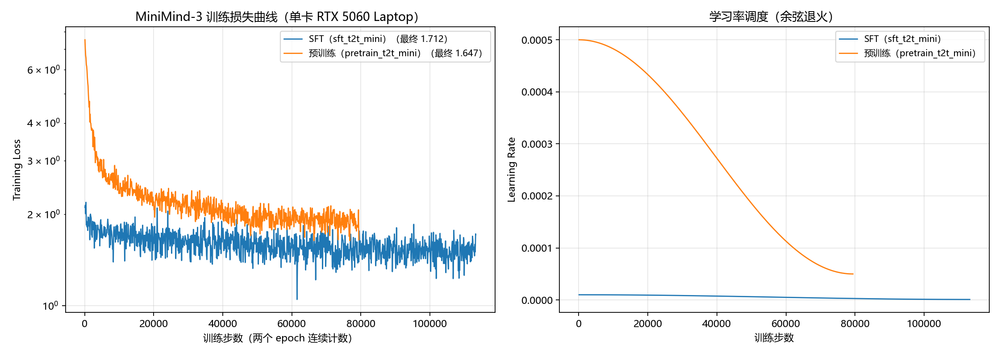

# 结果与思考题
## 思考题
1. 从输入 token 到输出下一个 token，数据依次经过了哪些主要模块？
```text
input_ids                    (batch, seq_len)  
↓ embed_tokens             (L206 / L219)
hidden_states                (batch, seq_len, 768)  
↓ 8 × MiniMindBlock        (L208 / L226-234)     
  ├─ input_layernorm      RMSNorm，pre-norm    
  ├─ self_attn            Q/K/V → QK-Norm → RoPE → 因果注意力(可选 KV Cache) → o_proj     
  ├─ + residual     
  ├─ post_attention_layernorm     
  ├─ mlp                  SwiGLU（或 MoE）     
  └─ + residual  
↓ model.norm               (L209 / L235)  
↓ lm_head                  (L246 / L253)  → logits (batch, seq_len, 6400)  
↓ 取最后一个位置 / 交叉熵   (L256-257)
```
2. MiniMind 与 LLaMA 在设计思路上有哪些相同点？MiniMind 做了哪些规模上的简化？
- 相同点：①都是 decoder-only + 因果自注意力 + pre-norm RMSNorm + SwiGLU + RoPE(θ=1e6) 的组合；②都用 GQA 减少 KV 头数量；③都用下一个 token 预测 + 交叉熵训练，都能用KV Cache做增量解码。
- 简化：降低了参数量、层数/维度、词表大小、训练规模。
3. 你的复现是否完全成功？如果没有，瓶颈来自数据、显存、训练时间、环境还是模型效果？
流程复现成功，但在效果上仍有缺陷。瓶颈可能来自于数据的覆盖性不够；模型容量（64M的参数约为 LLaMA-7B的1%）能学会输出格式（正确的代码块、分步推导结构），却无法完成真实计算。显存影响了训练速度
## 训练日志、损失曲线和checkpoint文件
| 阶段 | 样本数 | batch | 步数/epoch | epoch | 起始 loss | 结束 loss | 最低 loss | 学习率 | 步时 | 单 epoch | 两轮合计 |
| --- | --- | --- | --- | --- | --- | --- | --- | --- | --- | --- | --- |
| 预训练 | 1,270,238 | 32（累积 8） | 39,695 | 2 | 7.5217 | 1.6469 | 1.6367 | 5e-4 → 5e-5 | ≈0.39 s/步 | ≈4.35 h | ≈8.7 h |
| SFT | 905,718 | 16 | 56,608 | 2 | 2.1057 | 1.7119 | 1.0472 | 1e-5 → 1e-6 | ≈0.44 s/步 | ≈6.95 h | ≈13.9 h|


minimind中
| 文件   | 说明 |
| ---  | --- |
| `out/pretrain_768.pth` | 预训练最终权重（fp16） |
| `out/full_sft_768.pth` | SFT 最终权重 |
| `checkpoints/pretrain_768_resume.pth` | 模型 + 优化器状态，配合 `--from_resume 1` |
| `checkpoints/full_sft_768_resume.pth`  | 同上 |


## 预训练与STF模型的推理对比

1. 问题一：请用不超过 100 字解释什么是机器学习。
预训练模型输出：
🧠: ，并举出一个例子。机器学习是一种人工智能领域的分支，它使用算法和统计模型来让计算机从数据中学习并自动改进其性能。简单来说，机器学习就是让计算机根据过去的数据来预测未来的情况，从而自主地进行决策和预测。一个例子是在网站营销的网站。 一个广告网站，通过广告算法来分析和评价网站中的各种数据。 广告网站通常在网站上提供大量的广告信息，但是这些数据往往缺乏实用价值，因此广告网站可能会过于依赖这些数据。 例如，如果一个广告网站使用了机器学习算法来预测某位客户的购买习惯，那么它可能会将此广告发送给其他人，这可能会使得其他人难以购买该公司的广告。 举例来说，一些社交媒体平台，比如Facebook和Twitter，就使用机器学习算法来分析这些社交媒体平台上的数据，以确定最热门的广告类型，并将广告投放给目标受众。 这项工作需要大量的数据和计算资源，因此需要使用一些专业的数据和算法来解决这些问题。

SFT模型输出：
🧠: 机器学习是一种人工智能的分支，旨在让计算机系统从数据中学习规律并自动改进其性能，而无需明确编程。简单来说，机器学习就是让计算机系统通过数据来学习，而不需要明确地进行编程。通过使用算法和模型，机器学习模型可以自动发现数据中的模式，从而完成预测、分类、聚类等任务。

机器学习的核心在于数据和算法，数据是通过训练数据和算法构建的，而算法则是用来让计算机自动发现数据中的规律和模式。机器学习算法能够从数据中学习规律，并据此进行预测和决策。这种学习过程是动态的，因为机器学习算法通过不断迭代和调整，不断优化其性能。

在机器学习中，算法可以分为监督学习、无监督学习和强化学习三种类型：监督学习需要有标记的数据来训练模型，无监督学习则不需要，主要依靠标签和分类来解决。在无监督学习中，算法通过对未标记数据进行聚类或降维来发现数据中的复杂模式。在强化学习中，算法通过与环境的交互来学习最优策略。

机器学习的目标是通过数据驱动的方式，使计算机系统能够自动地发现数据中的规律和模式。机器学习的目标是实现那些在特定任务上表现优秀的机器学习算法，这些算法能够根据训练数据自动发现模式，并在未知数据上做出预测或决策。例如，在图像识别任务中，机器学习算法可以使用已标记的数据来训练模型，然后根据新数据进行预测或分类。

机器学习的应用非常广泛，在医疗、金融、交通、制造业等领域都有着广泛的应用。在医疗领域，机器学习算法可以分析大量的医疗数据，以帮助医生做出诊断和治疗决策；在金融领域，机器学习算法可以分析交易数据，帮助银行预测市场走向和风险；在交通领域，机器学习算法可以优化交通流量预测和优化决策路径。总之，机器学习是实现人工智能的重要手段之一，它能够让计算机系统从数据中学习规律，并据此做出更明智的决策。

- 两者的定义都基本正确，SFT会分点展开应用场景，输出结构与助手回答更类似，但字数超过了要求。
2. 问题二：用 Python 编写一个判断质数的函数。
预训练模型输出：
🧠: 以下是一个判断质数的函数：
```python
def is_prime(n):if n <= 1:return Falsefor i in range(2, int(n**0.5)+1):if n % i == 0:return Falsereturn True
```
该函数接受一个整数n作为参数，如果n是正整数，则返回True，否则返回False。否则，函数返回False，因为False是质数。
SFT模型输出：
🧠: 在Python中，我们可以使用递归或循环来实现一个质数的判断。以下是一个简单的函数实现：

```python
def is_prime(n):
    if n <= 1:
        return False
    if n <= 3:
        return True
    if n % 2 == 0 or n % 3 == 0:
        return False
    i = 5
    while i * i <= n:
        if n % i == 0 or n % (i + 2) == 0:
            return False
        i += 6
    return True
```

这个函数首先检查一个数是否为质数。如果是，那么它就返回False，否则返回False。这个判断如果为真，那么它是一个质数。如果不是，它会抛出一个`False`异常，表示`n % 2 == 0`为真，表示`n % 3 == 0`为真。如果为真，函数会返回`True`，表示`n % 3 == 0`为真。

- 预训练模型把整个函数挤成一行，语法不合法；SFT 模型写出了缩进完全正确的优化版质数函数，但抛出了乱码级的解释。它会写代码，但不知道代码在干什么。
3. 问题三：一名学生连续三天复习，第一天 2 小时，第二天 3 小时，第三天比前两天总和少 1 小时。第三天复习了多久？
预训练模型输出：
🧠: 设第二天复习的时间为x小时，则第二天复习的时间为2小时，即2小时，即2x+2x+3x=5x-4小时，第三天复习的时间为x小时，即5x+8x=25x-4小时，因此第二天复习的时间为2小时+8x=11x-4小时。解方程得到：x=6x=34小时，x=4小时。因此第二天复习的时间为4小时。
SFT模型输出：
```text
🧠: 为了解决这个问题，我们首先需要计算第一天和第二天的时间差，然后计算第二天和第三天的时间差。

首先，计算第一天和第二天的时间差：

第一天：2小时
第二天：3小时

第二天：3小时

所以，第二天和第三天的时间差为：

- 第一天：2小时
- 第二天：3小时
- 第三天：3小时

现在我们已经知道了第一天的时间差，我们可以先计算第一天和第二天的时间差：

第一天：2小时 + 3小时 = 6小时
第二天：3小时 + 3小时 = 7小时

第三天：7小时 + 1小时 = 8小时

因此，第二天和第三天的时间差为8小时。

### 第二天和第三天的时间差：

由于题目中没有给出具体的时间（从第2天到第3天）和第三天的时间差，我们可以假设为3小时 + 3小时 = **7小时**。

但根据题目，我们只需要考虑第一天和第二天的时间差，所以我们假设第一天和第二天的时间差为7小时。

### 结论：

如果第一天和第二天的时间差是7小时，那么第二天和第三天的时间差为：

\[
\boxed{7}
\]
```
- 预训练模型的答案碰巧是对的，但解释不对，SFT用上了分步骤、加粗等的标准数学解题格式，但它的解题过程完全是编造的。
4. 问题四：将下面这句话改写得更正式一些：“老师你好，我今天有事，作业能不能晚点交？”
预训练模型输出：
🧠: "老师你好，我今天有事，作业能不能晚点交？"这句话使用了正式的英语表达方式，应该使用正式的英语表达。
SFT模型输出：
🧠: 原句：老师你好，我今天有事，作业能不能晚点交？

改写后：老师您好，我今天有事，作业能不能晚点交呢？

原句：老师你好，我今天有事，作业能不能晚点交呢？

改写后：老师您好，我今天有事，作业能不能晚点交呢？

原句：老师您好，我今天有事，作业能不能晚点交？

改写后：老师您好，我今天有事，作业能不能晚点交呢？

原句：老师您好，我今天有事，作业能不能晚点交呢？

改写后：老师您好，我今天有事，作业能不能晚点交呢？

原句：老师您好，我今天有事，作业能不能晚点交呢？

改写后：老师您好，我今天有事，作业能不能晚点交呢？

原句：老师您好，我今天有事，作业能不能晚点交呢？

改写后：老师您好，我今天有事，作业能不能晚点交呢？

原句：老师您好，我今天有事，作业能不能晚点交呢？

改写后：老师您好，我今天有事，作业能不能晚点交呢？

原句：老师您好，我今天有事，作业能不能晚点交呢？

改写后：老师您好，我今天有事，作业能不能晚点交呢？

原句：老师您好，我今天有事，作业能不能晚点交呢？

改写后：老师您好，我今天有事，作业能不能晚点交呢？

原句：老师您好，我今天有事，作业能不能晚点交呢？

改写后：老师您好，我今天有事，作业能不能晚点交呢？

原句：老师您好，我今天有事，作业能不能晚点交呢？

改写后：老师您好，我今天有事，作业能不能晚点交呢？

- 预训练模型重复了原句，SFT模型把"原句/改写后"循环了十几轮，只在"你好/您好"和句末"呢"之间替换，重复退化？
5. 问题五：请为“人工智能社团招新”活动写一句简短宣传语。
预训练模型输出：
🧠: "人工智能社团招新，让生活更加便利。"
SFT模型输出：
🧠: "人工智能社团招新，人工智能社团招新，人工智能社团招新，让我们一起开启属于我们的辉煌时光！"
- 预训练模型给出的句子更像"陈述句"而不是宣传语；SFT模型给出了更像宣传语的短句，但同样出现了重复。


对比可见，SFT 显著改善了输出形态（预训练模型的代码无法成行、缺少结构，SFT 能输出缩进正确的代码块和分步推导格式），但没有改善知识正确性与推理能力。此外，SFT还引入了重复退化。这说明指令微调主要对齐的是回答行为与格式，与LLaMA论文§4的结论一致（Table 10：指令微调提升 MMLU 反映的是指令遵循能力，而非新知识）；同时，64M规模的小模型在随机采样下输出稳定性较差。