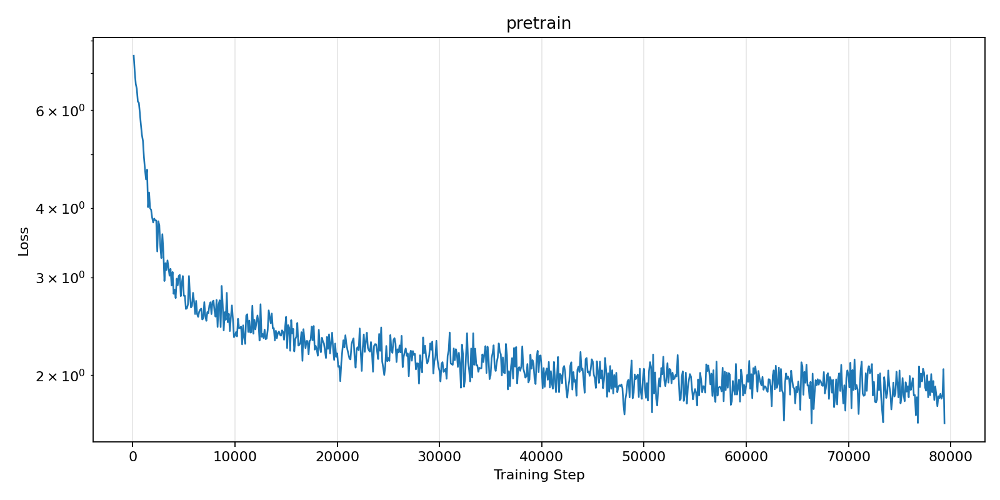
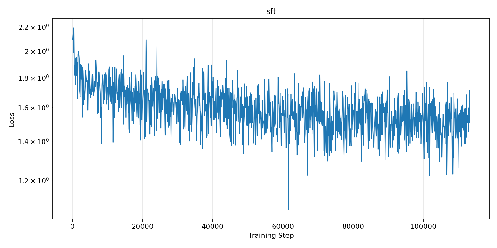

# 结果与思考题
## 思考题
1. 从输入 token 到输出下一个 token，数据依次经过了哪些主要模块？
```text
input_ids                    (batch, seq_len)  
↓ embed_tokens             (L206 / L219)
hidden_states                (batch, seq_len, 768)  
↓ 8 × MiniMindBlock        (L208 / L226-234)     
  ├─ input_layernorm      RMSNorm，pre-norm    
  ├─ self_attn            Q/K/V → QK-Norm → RoPE → 因果注意力(可选 KV Cache) → o_proj     
  ├─ + residual     
  ├─ post_attention_layernorm     
  ├─ mlp                  SwiGLU（或 MoE）     
  └─ + residual  
↓ model.norm               (L209 / L235)  
↓ lm_head                  (L246 / L253)  → logits (batch, seq_len, 6400)  
↓ 取最后一个位置 / 交叉熵   (L256-257)
```
2. MiniMind 与 LLaMA 在设计思路上有哪些相同点？MiniMind 做了哪些规模上的简化？
- 相同点：①都是 decoder-only + 因果自注意力 + pre-norm RMSNorm + SwiGLU + RoPE(θ=1e6) 的组合；②都用 GQA 减少 KV 头数量；③都用下一个 token 预测 + 交叉熵训练，都能用KV Cache做增量解码。
- 简化：降低了参数量、层数/维度、词表大小、训练规模。
3. 你的复现是否完全成功？如果没有，瓶颈来自数据、显存、训练时间、环境还是模型效果？
流程复现成功，但在效果上仍有缺陷。瓶颈可能来自于数据的覆盖性不够；模型容量（64M的参数约为 LLaMA-7B的1%）能学会输出格式（正确的代码块、分步推导结构），却无法完成真实计算。显存影响了训练速度





## 预训练与STF模型的推理对比

1. 问题一：请用不超过 100 字解释什么是机器学习。
预训练模型输出：
```text
🧠: 机器学习是一种通过计算机算法和统计模型来构建模型，使其能够通过数据自动学习和改进，从而能够对未知数据做出预测或决策。通过对输入数据进行处理后，机器学习可以识别出数据中的模式和规律，并利用这些模式和规律来做出预测或决策。
```

SFT模型输出：
```text
🧠: 机器学习是人工智能的一个分支，旨在让计算机系统能够从数据中学习并改进其性能。它利用统计学和算法来处理数据，使计算机能够进行预测、分类、聚类、回归等任务。

机器学习的核心在于利用统计学和算法对数据进行分析，然后将这些分析结果应用于未来的决策或预测。机器学习的基本思想是通过算法和模型来自动地从数据中学习，而不需要进行显式编程。

在实际应用中，机器学习应用广泛，如自然语言处理（NLP）、图像识别、推荐系统、智能决策等。机器学习算法可以从大量数据中学习模式，然后利用这些模式来完成特定任务。通过持续优化模型，机器学习算法能够不断提高准确性和效率，以更好地服务于用户。
```
- 两者的定义都基本正确，SFT会分段开应用场景，输出结构与助手回答更类似。
  
2. 问题二：用 Python 编写一个判断质数的函数。
预训练模型输出：
```text
🧠: 
 def is_prime(n):
    if n <= 1:
        return False
    else:
        return True# 调用函数并输出结果
print(is_prime(5))
# 打印结果
print(is_prime(100))
输出: True
True
range(2, 11)
False
for i in range(1, 1001, -1, -1):
    if n % i == 0:
        return False
    print(is_prime(100))
示例输出：

50
10
11
13
14
19
25
26
37
41
51
53
58
59
59
51
59
53
57
59
57
59
58
59
510
59
58
59
5
```


SFT模型输出：
```text
🧠: 要使用 Python 编写判断质数的函数，可以按照以下步骤进行：

1. 定义一个函数 `is_evens` 用于判断一个数是否为质数。

2. 定义一个函数 `is_evens`，用于判断一个数是否为质数。

3. 调用 `is_evens` 函数，传入一个数作为参数，并将结果存储在 `is_evens` 变量中。

下面是一个简单的函数实现：

python
def is_evens(num):
    if num < 2:
        return False
    num = int(num)
    return is_evens(num)


这个函数首先检查输入的数字是否为 2，如果是，则返回 `True`，表示输入的数字是质数。否则，返回 `False`。

你可以根据需要修改这个函数，例如：

```

- 预训练模型把和SFT模型的答案均不对，但SFT模型答案具有格式更接近一般聊天助手的回答。
3. 问题三：一名学生连续三天复习，第一天 2 小时，第二天 3 小时，第三天比前两天总和少 1 小时。第三天复习了多久？
预训练模型输出：
```text
🧠: 设第二天复习的天数为 x 天数。根据题意，可以列出以下的方程式：第一天：2x+3y=(5,6)第二天：3x-3y=(9,11,15,23,267)第三天：4x-3y=(9,312,241)，其中x为连续三天的时间。根据题意，可以列出以下的方程式：2x+3y=(9,312,241)x=(9,312,241)然后将该方程式变形，得到：x=(9+312+241)/9-3x=11/9-3x=3因此，第二天复习的天数为 3x+9y=27 天。
```

SFT模型输出：
```text
🧠: 要计算在三天（4 天）两天的总复习时间，我们需要知道第 $n$ 天的天数。不过，通常一个完整的天数计算公式是：

\[总天数 = 第 n \times n\]

其中：
- 第一天：2小时（三天）
- 第二天：3小时（三天）
- 第三天：2小时（三天）
- 第四天：3小时（三天）
- 第五天：2小时（三天）
- 第六天：2小时（三天）
- 第七天：2小时（三天）
- 第八天：3小时（三天）
- 第十天：2小时（三天）
- 第十天：3小时（三天）
- 第十天：2小时（三天）
```
- 预训练模型的答案过程都不对，SFT用上了分步骤等标准数学解题格式，但它的解题过程完全是编造的。
4. 问题四：将下面这句话改写得更正式一些：“老师你好，我今天有事，作业能不能晚点交？”
预训练模型输出：
```text
🧠: "你好老师，我今天有一定的事情要处理，能不能晚点交。改写得更正式一些：1. 我需要给老师看看。2. 我在课堂上犯了一些错误。3. 作业能不能晚点交，这是老师职责的一部分。4. 作业能不能晚点交。
。
```

SFT模型输出：
```text
🧠:  将“老师你好，我今天有事，作业能不能晚点交？”这句话改写得更正式一些，取决于你的具体需求和场景。以下是对原句的简化和修改建议：

1. **调整语序和结构**：改写时，可以调整句子的顺序和语序，使其更符合正式英语的表达习惯。例如，可以改变时态、语序和从句，使其更随意或有序。

2. **使用更口语化的表达**：避免使用可能引起歧义的词汇，如“老师”、“作业”、“作业能不能晚点交？”等。改写时，根据语境和上下文调整语调和用词。

3. **使用更正式的语气**：确保改写后的句子在正式的语气中表达清晰、正式。例如，可以将“老师”改为“我今天有事，作业能不能晚点交？“
```

- 预训练模型答案与要求无关，SFT模型分点给出了一些建议，具有格式，但没有具体的改动。
5. 问题五：请为“人工智能社团招新”活动写一句简短宣传语。
预训练模型输出：
```text
🧠:  "人工智能社团招新"， 这是一个简短而富有创意的宣传语，可以吸引读者的注意力并增加品牌知名度。
```

SFT模型输出：
```text
🧠: 【【人工智能社团招新】：开启人工智能社团新时代】：开启人工智能社团新时代，开启人工智能社团新时代！

【【宣传语】：在数字化与智慧的交汇中，AI与人类的共生，共同推动科技进步与人文关怀。】

---

【社区名】：【人工智能社团名称】

在这个充满无限可能的平台上，【人工智能社团名称】，开启人工智能社团新时代！

---

【注】：此标题可能旨在吸引特定群体的注意，以吸引特定群体的参与。同时，避免过于笼统的表述，保持广告语的创意和感染力。

---

【标题】：人工智能社团招新，共同开启人工智能社团新时代！

---

【注】：此标题旨在激发用户对

```
- 预训练模型解析了这句标语，答案与要求无关；SFT模型给出了宣传语，也具有相应的格式，但略显混乱。


对比可见，SFT 显著改善了输出形态（预训练模型的、缺少结构，SFT 能输出分步推导格式），但没有改善知识正确性与推理能力。这说明指令微调主要对齐的是回答行为与格式，与LLaMA论文§4的结论一致（Table 10：指令微调提升 MMLU 反映的是指令遵循能力，而非新知识）；同时，64M规模的小模型在随机采样下输出稳定性较差。